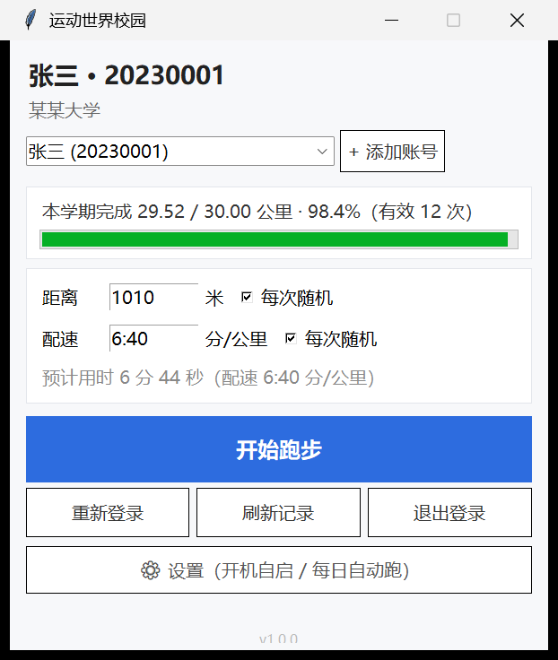
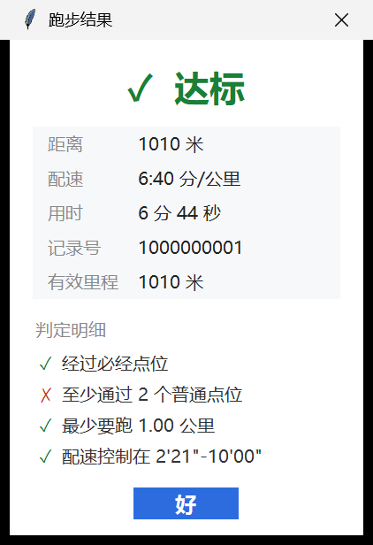
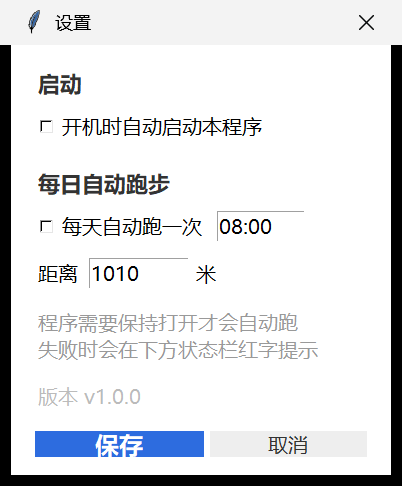

# Sport World Campus · Portable Desktop Client

[](https://www.microsoft.com/windows)
[](https://www.python.org/)
[](LICENSE)
[]()

> 中文 → [README.md](README.md)

---

> ## ⚠️ Read Before Use
>
> 1. **For Android reverse engineering and protocol research only**
> 2. **Commercial proxy-running, paid services, and resale are prohibited**
> 3. **Maintenance stops immediately upon request from the official team**
>
> Use only on **your own devices, your own accounts**, or in explicitly authorized
> test environments. You bear all consequences (invalidated records, account
> restrictions, etc.); the author assumes no liability.
>
> The protocol implementation comes from
> [Inverx/com.zjwh.android_wh_physicalfitness](https://github.com/Inverx/com.zjwh.android_wh_physicalfitness) (MIT).
> This project only adds a GUI and packaging on top of it, under the same terms.

---

> **This is a portable desktop client for [Inverx/com.zjwh.android_wh_physicalfitness](https://github.com/Inverx/com.zjwh.android_wh_physicalfitness).**
> Protocol reverse engineering, NetSec crypto reconstruction, Geetest slider solving and track synthesis are **entirely the original author's work**. This repository only does three things:
>
> 1. Wraps it in a tkinter GUI
> 2. Packages it into a **zero-dependency exe** (no Python / Node / environment setup required)
> 3. Fixes a few protocol bugs for app version 7.3.93


## Why this exists

The upstream `com.zjwh.android_wh_physicalfitness` is a pure-Python CLI tool. Complete, but with a real entry barrier:

```
git clone → install Python 3.10+ → playwright install chromium → memorize a pile of CLI flags
```

Too heavy for someone who just wants to log a run.

Hence this wrapper:

```
download zip → unzip → double-click exe → click buttons
```

**There is no new technology here — only a flattened learning curve.** To understand how the protocol actually works, go read the upstream project; its README is far more detailed than mine.

---

## Features

| Feature | Description |
|---|---|
| 🖥️ **GUI** | No commands to memorize — just buttons |
| 🚀 **Zero dependency** | Ships its own Python runtime, Node.js and Playwright; only needs the Edge browser that ships with Windows |
| 📊 **Semester progress** | Completed distance and valid-run count on launch |
| ✅ **Verdict breakdown** | After each run, a dialog lists every validation rule and whether it passed |
| 🎲 **Parameter jitter** | Slight randomization of distance and pace each run |
| 💾 **Settings memory** | Reopens with your last distance / pace |
| 👥 **Multi-account** | Dropdown to switch between accounts |
| ⏰ **Daily auto-run** | Optional; fires once a day at a chosen time |
| 🔌 **Launch on boot** | Optional; starts minimized and ready |
| 🛡️ **Crash guard** | Writes `error.log` and shows a dialog instead of vanishing silently |

---

## Quick Start

### 1. Download

Grab the latest `SportWorld-vX.X.X.zip` (~50 MB) from [Releases](../../releases).

### 2. Unzip and run

Extract anywhere, double-click `SportWorld.exe`.

**Nothing to install.**

### 3. Log in

Click **登录** (Log in), enter your phone number and password. A browser window pops up to solve the Geetest slider automatically — **leave it alone**, it takes 20–60 seconds.

### 4. Run

Enter distance and pace, click **开始跑步** (Start run).

---

## Interface

**Main window**



**Result dialog after a run**



**Settings (autostart / daily run)**



## Architecture

```
┌──────────────────────────────────────────────┐
│  SportWorld.exe  (PyInstaller bundle)        │
│  ├─ gui.py             tkinter UI            │
│  └─ _internal/         Python 3.12 runtime   │
├──────────────────────────────────────────────┤
│  com.zjwh.../协议/7.3.92/                     │
│  ├─ login/             auth + Geetest slider │
│  ├─ policy/            rules, fences, points │
│  ├─ running/           track synthesis, OBS  │
│  ├─ history/           record queries        │
│  └─ telemetry/         analytics simulation  │
├──────────────────────────────────────────────┤
│  node/                                       │
│  ├─ node.exe           portable Node.js      │
│  └─ node_modules/      Playwright            │
└──────────────────────────────────────────────┘
          ↓ drives
    System Microsoft Edge
    (Playwright-controlled for the slider)
```

**Why bundle Node but not Chromium:** Chromium alone is 426 MB, while Windows 10/11 ships with Edge (also Chromium-based). Bundling only Node + Playwright and reusing the system browser drops the package from 300+ MB to 50 MB.

---

## Protocol-Layer Fixes

Built on [Inverx/com.zjwh.android_wh_physicalfitness](https://github.com/Inverx/com.zjwh.android_wh_physicalfitness) (7.3.92 suite), adapted for app version 7.3.93:

| # | Issue | Symptom | Fix |
|---|---|---|---|
| 1 | Wrong unit for `speed` | Runs always judged "not valid"; pace looked superhuman | Server interprets it as *pace* (min/km) × 1000, not *speed* (m/s) × 1000 |
| 2 | `(0,0)` used as track center when no geofence | Track generated in the Gulf of Guinea | Call the fixed-checkpoint API and use the real track center |
| 3 | Verdict read from `is_valid` | Always `False`; UI always showed "failed" | Use the `complete` field instead |
| 4 | Semester fields renamed in 7.3.93 | Valid-run count always 0 | Support `sname` / `semesterGoal` / `semesterValid` with fallbacks |
| 5 | `DeviceId` regenerated every launch | Repeated logins triggered error 10121 (device conflict) | Persist the first generated ID and reuse it |
| 6 | Checkpoint API rate limit unhandled | Rejected after 3 calls in 5 minutes | Cache checkpoints locally and read from cache first |

All patches are marked with `[PATCH]` comments in the original source files.

---

## Known Limitations

- **Single-device login** — the server allows one active session per account; logging in elsewhere kicks the previous one (error 10121)
- **Login requires a browser** — Geetest v4 requires a real browser, hence the dependency on system Edge
- **Version-sensitive** — protocol changes with app updates and may need re-adaptation
- **Only submits run records** — does not touch any other app functionality

---

## Credits

- [Inverx](https://github.com/Inverx) — protocol reverse engineering and pure-Python implementation
- [hang666/JustTrustMePro](https://github.com/hang666/JustTrustMePro) — HTTPS certificate pinning analysis tool
- [Playwright](https://playwright.dev/) — browser automation

---

## License

MIT License