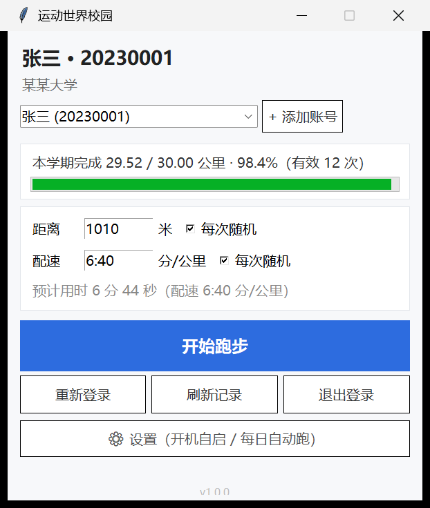
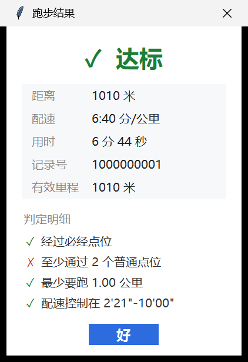
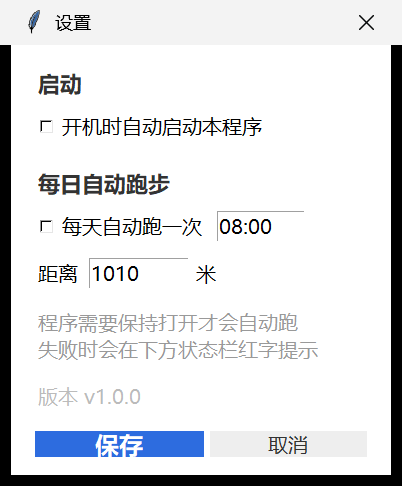

# 运动世界校园 · 免安装图形客户端

[](https://www.microsoft.com/windows)
[](https://www.python.org/)
[](LICENSE)
[]()

> English → [README.en.md](README.en.md)

> **本项目是 [Inverx/com.zjwh.android_wh_physicalfitness](https://github.com/Inverx/com.zjwh.android_wh_physicalfitness) 的免安装图形客户端。**
> 协议逆向、NetSec 加密还原、极验滑块破解、轨迹合成等核心工作**全部来自原作者**，本仓库只做三件事：
>
> 1. 套一层 tkinter 图形界面
> 2. 打包成**零依赖 exe**（不用装 Python / Node / 配环境）
> 3. 修了几个适配 App 7.3.93 的协议 bug

## 为什么做这个

原项目 `com.zjwh.android_wh_physicalfitness` 是纯 Python 命令行工具，功能完整但门槛不低：

```
git clone → 装 Python 3.10+ → playwright install chromium → 记一堆命令行参数
```

对只想跑个步的同学来说太重了。

所以做了这个封装版：

```
下载 zip → 解压 → 双击 exe → 点按钮
```

**技术本身没有新东西，只是把门槛削平了。** 想了解协议怎么实现的，请直接去看原项目——那边的 README 写得比我详细得多。

---

## 功能

| 功能 | 说明 |
|---|---|
| 🖥️ **图形界面** | 不用记命令，点按钮就行 |
| 🚀 **零依赖** | 自带 Python 运行时、Node.js、Playwright，只需系统自带 Edge |
| 📊 **学期进度** | 打开就显示已完成里程和有效次数 |
| ✅ **判定可视化** | 跑完弹窗列出每条规则的通过情况 |
| 🎲 **参数随机** | 每次距离和配速小幅浮动，不打固定节奏 |
| 💾 **参数记忆** | 关掉重开还是上次的设置 |
| 👥 **多账号** | 下拉框切换，适合帮同学跑 |
| ⏰ **每日自动** | 设置时间，到点自动跑一次（可选） |
| 🔌 **开机自启** | 可选开启，开机自动待命 |
| 🛡️ **异常兜底** | 崩溃时写 `error.log` 并弹窗，不无声消失 |

---

## 快速开始

### 1. 下载

从 [Releases](../../releases) 下载最新版 `运动世界跑步工具-vX.X.X.zip`（约 50 MB）。

### 2. 解压运行

解压到任意目录，双击 `SportWorld.exe`。

**不需要安装任何东西。**

### 3. 登录

点「登录」，输入手机号和密码。会弹出一个浏览器窗口自动过极验滑块，**别关它**，等 20~60 秒。

### 4. 跑步

填距离和配速，点「开始跑步」。

---

## 界面

**主界面**



**跑完弹结果窗**



**设置（开机自启 / 每日自动跑）**



## 技术架构

```
┌─────────────────────────────────────────┐
│  SportWorld.exe（PyInstaller 打包）      │
│  ├─ gui.py            tkinter 界面       │
│  └─ _internal/        Python 3.12 运行时 │
├─────────────────────────────────────────┤
│  com.zjwh.../协议/7.3.92/                │
│  ├─ login/            登录 + 极验滑块    │
│  ├─ policy/           规则、围栏、打卡点  │
│  ├─ running/          轨迹合成、OBS 上传  │
│  ├─ history/          成绩查询            │
│  └─ telemetry/        埋点模拟            │
├─────────────────────────────────────────┤
│  node/                                   │
│  ├─ node.exe          便携 Node.js       │
│  └─ node_modules/     Playwright         │
└─────────────────────────────────────────┘
         ↓ 调用
    系统自带的 Microsoft Edge
    （Playwright 驱动，跑极验滑块）
```

**为什么打包 Node 而不打包 Chromium**：Chromium 要 426 MB，而 Windows 10/11 都自带 Edge（也是 Chromium 内核）。打包时只带 Node + Playwright，浏览器用系统的，包体积从 300+ MB 降到 50 MB。

---

## 协议层修复

本项目在 [Inverx/com.zjwh.android_wh_physicalfitness](https://github.com/Inverx/com.zjwh.android_wh_physicalfitness) 的 7.3.92 实现基础上，适配 App 7.3.93 时修了以下问题：

| # | 问题 | 表现 | 修复 |
|---|---|---|---|
| 1 | `speed` 字段单位错误 | 提交后配速被判「超人类水平」，始终未达标 | 服务端按「配速（分/km）×1000」解读，原实现传的是「速度（m/s）×1000」 |
| 2 | 围栏为空时圆心为 `(0,0)` | 轨迹生成在几内亚湾（大西洋海上） | 改为调用固定点位接口，用真实田径场中心 |
| 3 | 达标判定用了 `is_valid` | 恒为 `False`，界面永远显示未达标 | 改用 `complete` 字段 |
| 4 | 学期进度字段名不匹配 | 有效次数恒显示 0 | 7.3.93 改成 `sname` / `semesterGoal` / `semesterValid`，做兼容解析 |
| 5 | `DeviceId` 每次随机生成 | 重复登录触发 10121 设备互斥 | 首次生成后写入文件复用 |
| 6 | 五点接口限流未处理 | 5 分钟内调 3 次后被拒 | 点位缓存到本地，优先读缓存 |

这些改动都以 `[PATCH]` 注释标记在原文件中。

---

## 已知限制

- **单设备登录**：服务端限制同一账号只能一台设备在线，多开会互相踢线（错误码 10121）
- **密码登录需要浏览器**：极验 v4 滑块必须用真浏览器，所以登录依赖系统 Edge
- **协议版本敏感**：App 升级后协议可能失效，需重新适配
- **不影响真实运动数据**：本工具只提交跑步记录，不改动其他功能

---

## 免责声明

本项目**仅供学习与技术研究**（Android 协议逆向、图形界面开发、Python 打包），请勿用于：

- 商业牟利、收费代跑
- 破坏计算机信息系统
- 侵犯他人账号或数据

使用者应自行承担因使用本项目产生的一切后果（包括但不限于成绩作废、账号限制、校规处理）。

**本项目的协议层代码来自 [Inverx/com.zjwh.android_wh_physicalfitness](https://github.com/Inverx/com.zjwh.android_wh_physicalfitness)，遵循其原许可（MIT）。**

---

## 致谢

- [Inverx](https://github.com/Inverx) —— 运动世界校园协议逆向与纯 Python 实现
- [hang666/JustTrustMePro](https://github.com/hang666/JustTrustMePro) —— HTTPS 证书校验分析工具
- [Playwright](https://playwright.dev/) —— 浏览器自动化

---

## 许可

MIT License